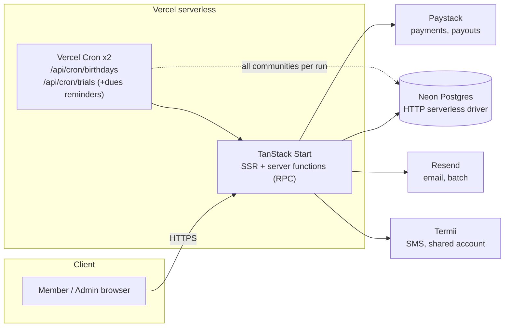
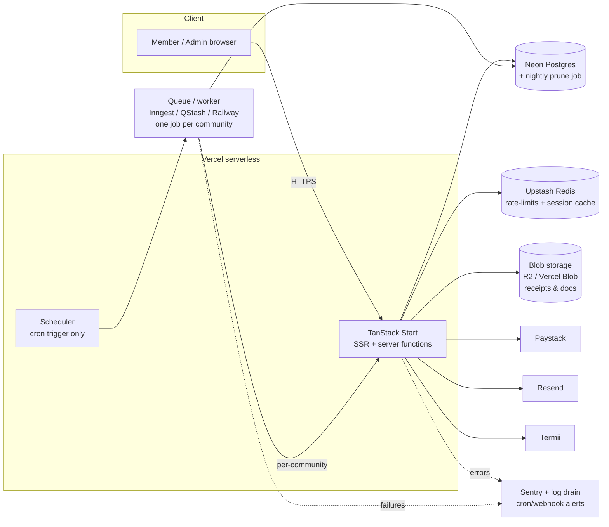

# Kommunity — Scaling Plan (to ~10,000 members / ~100 communities)

**Prepared:** August 2026
**Scope:** What the app looks like at ~10k members across ~100 communities, what strains first, and the prioritized changes. Grounded in the current codebase.

---

## TL;DR

10,000 members across 100 communities is **~100 members/community** and low‑tens‑of‑thousands of payment/ledger rows — **small for this stack.** Postgres doesn't notice it, and the request path (dashboards, dues views, reports) stays fast and looks identical to today.

This is a **targeted tune‑up, not a re‑architecture.** The pressure is on **batch/cron fan‑out and operational gaps**, not the database or the request path. The five changes that matter, in order:

1. **Chunk/queue the nightly crons** (they currently process all communities in one invocation → timeout). *P0*
2. **Prune sessions & rate‑limits** (nothing deletes expired rows today). *P0, cheap*
3. **Paginate + server‑side search the member list.** *P1*
4. **Move expense receipts out of Postgres into blob storage.** *P1*
5. **Add observability + cron/webhook failure alerting.** *P1*

Everything else is fine at this scale.

---

## Why the foundation holds

- **Neon HTTP serverless driver** (`@neondatabase/serverless`): every query is a stateless HTTP request, so there is **no connection‑pool exhaustion** as Vercel scales function instances out — the classic serverless‑Postgres failure mode doesn't apply here.
- **Stateless RPC server functions** scale horizontally on Vercel with no shared state.
- **Email and SMS are already batched/pooled** (`sendEmailsBatch` = 100/call, 3 concurrent; SMS send pool = 5 concurrent).
- **Multi‑tenant scoping** is enforced in every server function via `communityIdForAdmin` / `resolveActiveMember`.

Data volume is a non‑issue: 10k `members`, plus payments/ledger/expenses, is trivial for Postgres with the indexes already in place (`members(community_id)`, `members(community_id,status)`, `dues_payments(plan_id)`, `sessions(expires_at)`, etc.).

---

## Current architecture

**The weak edge is the dotted line:** the cron routes do all‑communities work inside a single serverless invocation.

---

## Findings & changes (prioritized)

### P0 — Do before / around this scale

#### 1. Nightly crons process every community in one invocation → timeout
- **Where:** `runDuesReminderJob` (`src/lib/cron/dues-reminders.server.ts`) loops **all** communities with a dues plan, calling `computeCommunityArrears` (several queries + a JS member loop) and sending emails/SMS per community — all in one request. `runBirthdayJob` is similar, and its WhatsApp path sends sequentially per member.
- **Why it breaks:** Vercel function timeout (~10s Hobby / up to 300s Pro). At 100 communities this exceeds Hobby and can approach Pro. You are also **already at Vercel's 2‑cron Hobby ceiling** (`/birthdays`, `/trials`).
- **Change:** stop doing all‑communities‑in‑one‑request. Options, cheapest first:
  - **Chunk across invocations:** cron enqueues per‑community work; process N communities per run, or a cursor that advances each run.
  - **Queue / background worker:** Inngest or Upstash QStash to fan out one job per community; or the Railway worker already contemplated in the setup checklist. This also removes the 2‑cron limit constraint.
- **Effort:** M. **Impact:** high (prevents silent nightly failures).

#### 2. Sessions & rate‑limits grow forever (no pruning)
- **Where:** `sessions` rows are deleted only on logout/revoke (`session.server.ts`); expired sessions and rate‑limit rows are never cleaned up.
- **Why it matters:** steady table bloat and write contention on the busiest tables (every login/join/SMS attempt writes a rate‑limit row).
- **Change:** a tiny cleanup cron — `DELETE FROM sessions WHERE expires_at < now()` and prune old rate‑limit rows — or move rate‑limiting to **Upstash Redis** (faster, and off the primary DB). Fold the cleanup into an existing cron to stay within the cron limit.
- **Effort:** S. **Impact:** medium, and it's a quick win.

### P1 — Add soon

#### 3. Member list has no pagination or server‑side search
- **Where:** `listMembers` returns **every** member for a community to the browser (no `LIMIT`/`OFFSET`/search).
- **Why it matters:** fine at ~100/community, but a single large community (e.g. a 4,000‑member alumni body) ships thousands of rows every page load.
- **Change:** server‑side pagination + search/filter (name/email/phone/status), with the existing filters moved server‑side.
- **Effort:** M. **Impact:** medium (localized to large communities).

#### 4. Expense receipts stored as base64 in Postgres
- **Where:** `community_expenses.receipt_base64` (chosen deliberately for a self‑contained v1).
- **Why it matters:** binary blobs in the primary DB inflate row sizes, slow backups, and grow unbounded.
- **Change:** move receipts (and any future member documents) to **blob storage** — Vercel Blob / Cloudflare R2 / S3 — storing only a URL/key in the row. Serve via a short‑lived signed URL.
- **Effort:** M. **Impact:** medium (DB hygiene, backup speed).

#### 5. Observability & alerting
- **Where:** errors are `console.error` only.
- **Why it matters:** at 100 communities you must know when a nightly cron, a Paystack webhook, or a Termii DLR silently fails — otherwise a broken job or a dropped payout goes unnoticed for days.
- **Change:** error tracking (Sentry), structured logs, and **success/failure alerts on crons and webhooks** (e.g. a heartbeat / dead‑man's‑switch on the nightly jobs).
- **Effort:** S–M. **Impact:** high operationally.

### P2 — Watch; revisit only if a *single* community gets large

- **Arrears computed in JS** (`computeCommunityArrears` fetches members + payments and loops). Fine at ~100 members; if one community reaches thousands of members / tens of thousands of payments, push the aggregation into SQL (`GROUP BY`, window functions).
- **No row‑level security** — isolation relies on every server function scoping correctly. Correct today; as the team grows, add Postgres **RLS** as defense‑in‑depth.
- **SMS shared‑Termii float** — the reserve‑monitoring panel already exists; with 100 wallets, operationally keep the Termii reserve ≥ total community balances.
- **Backups/DR** — confirm Neon PITR and run one restore drill.

---

## Target architecture at scale

New/changed components are highlighted; the request path is unchanged.

**What changed vs today:** cron fan‑out moves behind a **queue/worker** (item 1); a **prune job** keeps `sessions`/rate‑limits trim (item 2, or Redis takes rate‑limits entirely); **blob storage** holds receipts (item 4); **Sentry + alerts** wrap crons and webhooks (item 5). The browser → app → Postgres request path is identical.

---

## Prioritized roadmap

| # | Change | Priority | Effort | Why |
|---|--------|----------|--------|-----|
| 1 | Chunk/queue nightly crons (dues reminders, birthdays) | **P0** | M | Prevents nightly timeouts at 100 communities; frees the 2‑cron limit |
| 2 | Session + rate‑limit cleanup (cron or Redis) | **P0** | S | Stops unbounded table growth; quick win |
| 3 | Member list pagination + server‑side search | P1 | M | Handles large individual communities |
| 4 | Move expense receipts to blob storage | P1 | M | DB hygiene, faster backups |
| 5 | Observability (Sentry) + cron/webhook alerts | P1 | S–M | Know when things silently fail |
| 6 | Arrears aggregation in SQL | P2 | M | Only if one community gets very large |
| 7 | Postgres RLS (defense‑in‑depth) | P2 | M | As the team/tenancy grows |

---

## What NOT to change (avoid over‑engineering)

- Don't swap the Neon HTTP driver or add a connection pooler — the HTTP driver is the right fit for serverless and isn't the bottleneck.
- Don't shard or move off Postgres — data volume is nowhere near needing it.
- Don't rewrite the request path — it scales as‑is well past 10k/100.

The whole list above is realistically a **1–2 sprint** effort, front‑loaded on items 1 and 2.
